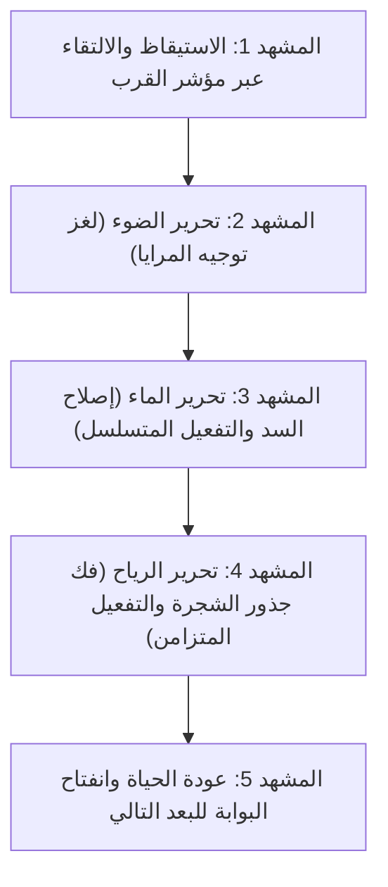
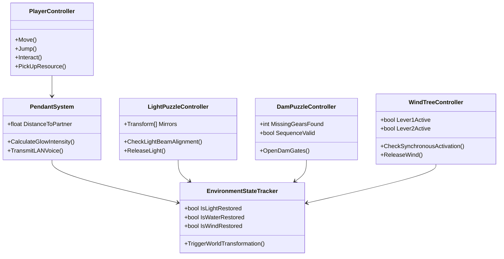

# وثيقة تصميم اللعبة (Game Design Document - GDD)
## مشروع: الغابة الأسيرة (The Captive Forest) - المرحلة الأولى

---

## 1. الملخص التنفيذي والرؤية العامة (Executive Summary & Vision)

| البند | البيان |
|---|---|
| **اسم اللعبة** | الغابة الأسيرة (The Captive Forest) |
| **النوع (Genre)** | مغامرة وألغاز تعاونية ثنائية (Two-Player Co-op Puzzle Adventure) |
| **المنصة (Platform)** | الحاسوب الشخصي (PC - Windows) عبر شبكة محلية (LAN) |
| **محرك اللعبة** | Unity 2022.3 LTS / Unity 6 (URP) |
| **نمط اللعب** | لاعبين اثنين (2 Players) - جهاز مستقل لكل لاعب (Host / Client) |
| **الجمهور المستهدف** | محبو ألعاب التعاون الثنائي والألغاز (مثل عشاق *It Takes Two* و *We Were Here*) والمؤسسات التعليمية لتعزيز العمل الجماعي والتواصل. |

### الرؤية الأساسية (The Core Vision)
تقديم تجربة مغامرة تفاعلية ثلاثية الأبعاد لا يمكن الفوز بها بشكل فردي؛ حيث تتكامل ميكانيكا اللعب مع فلسفة التواصل البشري. كل تحدٍ في اللعبة مصمم هندسياً ليتطلب شريكين: أحدهما يرى ما لا يراه الآخر، أو يمتلك ما يحتاجه شريكه، ليتجسد المعنى الحقيقي لعبارة: **"لا يمكن للاعب واحد إعادة الحياة إلى العالم، بل يحتاج إلى الآخر ليكتمل الطريق"**.

---

## 2. القصة وعالم اللعبة (Narrative & World Building)

### 2.1 الخلفية الدرامية (The Lore)
في عالم قديم تحكمه قوى التناغم الطبيعي، اختلت موازين الطاقة الحيوية إثر حدث غامض أدى إلى عزل وحبس العناصر الكونية الثلاثة المغذية للطبيعة:
1. **الضوء (Light):** حُبس داخل كبسولة بلورية سحرية، مما أغرق الغابة في ظلام دامس وسكون موحش.
2. **الماء (Water):** احتُجز خلف سد صخري عملاق تعطلت آلياته، فتحولت الأنهار إلى مجارٍ جافة وماتت النباتات المحيطة.
3. **الرياح (Wind):** قُيدت داخل شريان شجرة أسطورية عملاقة بواسطة جذور سحرية محكمة، فغابت حركة الهواء وسكتت أصوات الحياة.

### 2.2 الشخصيتان والقلادتان المترابطتان (Characters & Resonance Pendants)
- **الشخصيات:** شخصيتان أسطوريتان بتصميم سيمبولوجي مميز (تميز لوني بسيط على الملابس كالأزرق والأخضر الزمردي للتمييز بين Player 1 و Player 2).
- **القلادة السحرية (Resonance Pendant):**
  - حول عنق كل لاعب قلادة تتوسطها جوهرة سحرية.
  - تعمل القلادة كوسيلة **تواصل صوتي مباشر (In-Game LAN Voice)** بين اللاعبين.
  - تعمل كـ **بوصلة قرب بصرية (Proximity Indicator)**: كلما اقتربت المسافة المكانية بين اللاعبين، زادت شدة توهج الجوهرة وتغير تردد نبضها الضوئي وصوت الرنين الخافت الصادر منها.

---

## 3. المشاهد الخمسة للمرحلة الأولى (Level 1: Scene-by-Scene Walkthrough)

---

### المشهد الأول: الاستيقاظ في الغابة والبحث عن الشريك (Awakening & Reunion)
- **الحالة البيئية:** بيئة معتمة بالكامل، أشجار متصلبة بلا حركة، نهر جاف، صمت مطبق.
- **مواقع البدء:** يبدأ كل لاعب في بقعة جغرافية منفصلة تفصل بينهما تلال صخرية وجذوع أشجار عملاقة تمنع الرؤية المباشرة.
- **التفاعل التمهيدي:**
  - يختبر اللاعبان حركة الشخصية والقفز وكاميرا الرؤية.
  - يكتشف اللاعبان أن صوتيهما مسموعان عبر القلادة دون الحاجة لرؤية بعضهما.
  - يتبادل اللاعبان وصف المعالم المحيطة ("أنا بجانب صخرة حلزونية"، "أنا أرى جذع شجرة مكسور").
  - بملاحظة توهج القلادة، يسترشدان باتجاه التوهج الأقوى حتى يلتقيا عند جسر خشبي متداعٍ.
- **الهدف المنجز:** الالتقاء واكتشاف رموز العناصر الثلاثة المحتجزة.

---

### المشهد الثاني: البحث عن الضوء وتحريره (The Light Element)
- **الموقع:** فسحة غابية واسعة مظلمة يتوسطها مذبح حجري فوقه "كبسولة زجاجية سحرية" ينبعث منها وميض أسر الضوء.
- **طبيعة اللغز (Light Reflection Puzzle):**
  - على المذبح كبسولة محاطة بثلاثة أقفال بلورية تتطلب سقوط أشعة مركزة عليها في آن واحد.
  - يتوزع في المنطقة برج باعث للضوء و3 قواعد لمرايا حجرية قابلة للتدوير ومرايا إضافية ملقاة في محيط المنطقة.
- **التعاون المطلوب:**
  - اللاعب الأول يقف في نقطة مرتفعة لمراقبة مسار انعكاس الأشعة وتوجيه شريكه بالصوت ("قم بتدوير المرآة اليسرى 30 درجة لليمين").
  - اللاعب الثاني يقوم بتحريك وضبط زوايا المرايا السفلية أو تثبيت مرآة ناقصة.
- **أثر التحرير (Environmental Transformation):**
  - فور إصابة الأقفال الثلاثة، تنفجر الكبسولة بنور ساطع.
  - تتفعل الإضاءة الحجمية (Volumetric Sunlight God Rays).
  - تتحول ألوان أوراق الأشجار من الرمادي الباهت إلى الأخضر الندي، وتنكشف المسارات الأرضية المؤدية لمجرى النهر.

---

### المشهد الثالث: البحث عن الماء وتحريره (The Water Element)
- **الموقع:** حافة وادٍ صخري ينحدر إلى مجرى نهر جاف، ينتهي بسد حجري عظيم ذي بوابات مغلقة بإحكام.
- **طبيعة اللغز (Dam Gear Repair & Timed Sequence):**
  - **المرحلة الفرعية أ (جمع الموارد والإصلاح):** الآلية الميكانيكية للسد مكسورة؛ يحتاج اللاعبان للبحث عن (3 قطع خشبية قوية / تروس حجرية) متناثرة في مسارات متفرقة ونقلها إلى لوحة التحكم الحجرية لإعادة تدوير التروس.
  - **المرحلة الفرعية ب (التفعيل المتسلسل الزمني):** تحتوي الآلية على 4 مفاتيح حجرية تفصل بينها مسافة. تظهر على جدار السد نقوش مضيئة توضح الترتيب الإلزامي لضغط المفاتيح، مع عد تنازلي (مثلاً 10 ثوانٍ) لإكمال التسلسل.
- **التعاون المطلوب:**
  - يتقاسم اللاعبان الأدوار: لاعب يتمركز عند المفتاحين (1 و 3) والآخر عند (2 و 4)، والتنسيق الدقيق عبر الصوت بالعد التنازلي لإنجاز التفعيل في الوقت المحدد.
- **أثر التحرير (Environmental Transformation):**
  - ترتفع بوابات السد الصخري بصوت هادر.
  - يتدفق شلال مائي متلألئ، وتملأ المياه مجرى النهر الجاف مع شيدر تفاعلي للمياه ورغوة الجريان.
  - تزهر أزهار اللوتس والنباتات المائية فوراً على ضفاف النهر وتفتح معبراً طبيعياً للعبور نحو الشجرة العملاقة.

---

### المشهد الرابع: البحث عن الرياح وتحريرها (The Wind Element)
- **الموقع:** قلب الغابة المحرم؛ شجرة أسطورية عملاقة تلتف حول جذعها جذور سحرية سوداء كالسلاسل، تحتجز بداخلها إعصار الرياح المضغوط.
- **طبيعة اللغز (Crystal Energy & Dual Synchronous Activation):**
  - **المرحلة الفرعية أ (تطهير الجذور العلوية والسفلية):** يحتاج اللاعبان لجمع (بلورات طاقة سحرية) لوضعها في محاريب حجرية عند أطراف الجذور لإذابة الطوق المحيط بنقاط الصعود.
  - **المرحلة الفرعية ب (التفعيل المزدوج المتزامن):**
    - تتشعب طريقان للصعود إلى منصتين متقابلتين في الشجرة.
    - منصة تتطلب قفزات منصية (Platforming)، ومنصة تتطلب تفعيل مصعد يدوي يعاونه فيه زميله.
    - في القمة، توجد رافعتان مقدستان تتطلبان التفعيل في **اللحظة ذاتها بالتزامن** ($\Delta t \le 0.5\text{s}$).
- **التعاون المطلوب:**
  - أحدهما يرفع الآخر، ثم يصعد كلاهما إلى قمّتي المسارين ويقومان بالعد التنازلي الصوتي ("3.. 2.. 1.. اسحب!") لضمان التزامن.
- **أثر التحرير (Environmental Transformation):**
  - تتفكك الجذور وتتحول إلى رماد ناصع.
  - تهب عاصفة رياح عليلة تنتشر في كامل الغابة، متزامنة مع شيدر تمايل أوراق الأشجار (Foliage Swaying) ومؤثرات جزيئية لأوراق الشجر المتطايرة (Particle Leaves).
  - تعود أصوات زقزقة الطيور وحفيف الأشجار إلى المشهد الصوتي بالكامل.

---

### المشهد الخامس: عودة الحياة ونهاية المرحلة (The Awakening Finale)
- **الحالة البيئية:** الغابة أصبحت في أبهى صورها: نور الشمس يتخلل الأغصان، النهر يجري بروعة، والرياح تداعب النباتات مع موسيقى تصويرية تصاعدية ملهمة.
- **الحدث الختامي:**
  - تبلغ قلادتا اللاعبين ذروة الرنين الضوئي (Resonance Maxima) مع هالة ذهبية مشتركة.
  - في أقصى مسار الغابة، تتلاشى الصخور لتكشف عن **بوابة حجرية غامضة منيرة (Ancient Portal)** كانت مخفية بالظلام والجفاف.
  - يتقدم اللاعبان معاً نحو البوابة، ويظهر مشهد سينمائي تفاعلي (In-Engine Cutscene) يوضح وميض العالم التالي (عالم الكهوف المتبلورة أو الصحراء الجليدية) مع شاشة إتمام المرحلة الأولى بنجاح.

---

## 4. آليات اللعب التفاعلية (Core Gameplay Mechanics)

### 4.1 تفاصيل الآليات الميكانيكية
1. **نظام التحكم بالحركة (Locomotion):** حركة بمنظور الشخص الثالث (Third-Person) مع قفز وتفاعل فيزيائي سلس وسرعة حركة متوازنة تشجع على الاستكشاف دون بطء ممل.
2. **نظام التفاعل (Interaction Framework):**
   - مؤشر تفاعلي وسطي ذكي (Smart Reticle / Outline Highlight) يظهر عند الاقتراب من كائن قابل للتفاعل (مرايا، رافعات، موارد).
3. **نظام الموارد المباشر (Direct Minimalist Inventory):**
   - حمل مورد واحد في اليد أو في مؤشر جيب بسيط (خشب، بلورات).
   - لا توجد قوائم معقدة؛ التفاعل مباشر: الضغط على المفتاح للالتقاط، ثم الاقتراب من الآلية المعطلة للضغط وإتمام التركيب فوراً.
4. **نظام التوقيت والتزامن (Synchronization Check):**
   - منطق برمجي موثق على الخادم (Server-Authoritative) لقياس فارق التفعيل بين مفاتيح اللاعبين، مع هامش سماحية محسوب بدقة ليناسب الشبكة المحلية ($300\text{ms} - 500\text{ms}$).

---

## 5. الأهداف التربوية وتنمية المهارات (Educational & Skill Matrix)

| المهارة المستهدفة | آلية تفعيلها في اللعبة | مؤشر النجاح والقياس |
|---|---|---|
| **الاستماع الفعّال (Active Listening)** | تلقي توجيهات الشريك في لغز توجيه المرايا دون رؤية الكبسولة مباشرة. | إنجاز زوايا الانعكاس بدون تكرار الأخطاء. |
| **التواصل اللفظي الدقيق (Clear Communication)** | وصف المعالم الجغرافية ومسارات المفاتيح وألوان البلورات عبر الصوت. | سرعة التقاء اللاعبين وسرعة فهم المطلوب. |
| **التنسيق الزمني (Temporal Coordination)** | التفعيل المتزامن لرافعات الشجرة والعد التنازلي التبادلي. | نجاح التفعيل المزدوج ضمن نافذة الـ 0.5 ثانية. |
| **الذاكرة العاملة (Working Memory)** | حفظ تسلسل المفاتيح الحجرية على السد وتوزيع الأدوار قبل بدء المؤقت. | إدخال التسلسل الصائب قبل انقضاء الـ 10 ثوانٍ. |
| **حل المشكلات التشاركي (Collaborative Problem Solving)** | استنتاج سبب عدم تحرك النهر أو عدم انفتاح كبسولة الضوء والبحث عن الخلل. | التوصل المنطقي لمكان الموارد والأجزاء الناقصة. |

---

## 6. واجهة المستخدم والتغذية البصرية والسمعية (UI/UX & Audio Direction)

- **فلسفة الواجهة المنعدمة (Diegetic & Minimalist UI):**
  - لا توجد أشرطة صحة أو عدادات معقدة تعكر صفو الانغماس البصري.
  - مؤشر القرب مبني داخل اللعبة (Diegetic) من خلال القلادة المعلقة على الشخصية.
  - رسائل التوجيه تظهر كنقوش صخرية أو تلميحات بصرية ناعمة عند الاقتراب.
- **التصميم الصوتي (Audio Landscape):**
  - **الحالة الأولى (الموت الساكن):** نغمات أمبيانت خفيضة وموحشة، صدى خطوات جافة، غياب أصوات الرياح والمياه.
  - **مرحلة الضوء:** إضافة نغمات وتريات دافئة ولمعان صوتي ملهم (Harmonic Shimmer).
  - **مرحلة الماء:** اندفاع خرير المياه والشلالات وتلاشي الصمت.
  - **مرحلة الرياح:** إضافة مؤثرات حفيف أوراق الشجر وأصوات الطيور الحية، واكتمال الأوركسترا الاحتفالية في المشهد الخامس.
