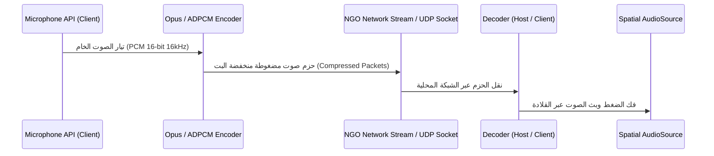

# المعمارية التقنية للعبة (Technical Architecture)
## مشروع: الغابة الأسيرة (The Captive Forest)

---

## 1. الهيكل العام والمواصفات البرمجية (System Overview)

تم تصميم معمارية اللعبة لتكون **مستقلة بالكامل عن الإنترنت (Offline-First)** وتعمل بكفاءة فائقة على أجهزة الحاسوب الشخصية المرتبطة بشبكة محلية (**LAN**).

```
                      +---------------------------------------+
                      |       Host Machine (Player 1)         |
                      |  - Unity Game Client                  |
                      |  - Authoritative Game Server (NGO)    |
                      |  - UDP Broadcast Service              |
                      |  - LAN Audio Server / Relay           |
                      +-------------------+-------------------+
                                          |
                                          | LAN (UDP / TCP)
                                          | Local Network (Router / Switch)
                                          |
                      +-------------------+-------------------+
                      |      Client Machine (Player 2)        |
                      |  - Unity Game Client                  |
                      |  - LAN Auto-Discovery Client         |
                      |  - Voice Audio Client (Mic Stream)   |
                      +---------------------------------------+
```

---

## 2. بنية الشبكة وإدارة الجلسات (Multiplayer Architecture)

### 2.1 إطار العمل (Networking Framework)
- **Netcode for GameObjects (NGO)** مدعوماً بـ **Unity Transport Protocol (UTP)**.
- **النمط المعماري:** **Host-Client Architecture**.
  - اللاعب الأول يستضيف الخادم واللعبة معاً (Host).
  - اللاعب الثاني يتصل كعميل (Client).
  - الخادم هو المرجع الأوحد (Server-Authoritative) لمنطق الألغاز، الموارد، والأحداث البيئية لمنع أي تعارض (Desynchronization).

### 2.2 ميزة الاكتشاف التلقائي عبر الشبكة المحلية (LAN Auto-Discovery)
لتفادي إجبار اللاعبين على إدخال عناوين IP يدوياً في سطر الأوامر، يتم استخدام بروتوكول **UDP Broadcast Discovery**:
- يقوم الـ Host بإرسال حزم UDP دورية (Broadcast Ping) على المنفذ `7777` تحوي اسم الغرفة وهوية اللعبة.
- يقوم الـ Client بالتنصت على المنفذ، وعند استقبال الإشارة، يظهر اسم الـ Host فوراً في القائمة مع زر "انضمام بضغطة واحدة".

```csharp
// نموذج أولي لمكون اكتشاف الشبكة المحلية LAN Discovery
using System.Net;
using System.Net.Sockets;
using System.Text;
using UnityEngine;

public class LanDiscovery : MonoBehaviour
{
    private const int DiscoveryPort = 7777;
    private const string GameSignature = "CAPTIVE_FOREST_HOST";
    private UdpClient _udpClient;

    public void StartBroadcasting(string roomName)
    {
        _udpClient = new UdpClient();
        _udpClient.EnableBroadcast = true;
        InvokeRepeating(nameof(BroadcastPresence), 0f, 1.5f);
    }

    private void BroadcastPresence()
    {
        byte[] payload = Encoding.UTF8.GetBytes($"{GameSignature}:{NetworkManager.Singleton.GetComponent<UnityTransport>().ConnectionData.Port}");
        _udpClient.Send(payload, payload.Length, new IPEndPoint(IPAddress.Broadcast, DiscoveryPort));
    }
}
```

### 2.3 مزامنة البيانات وحالة الألغاز (State Synchronization)
- **حركة اللاعبين:** `NetworkTransform` مع إعدادات Interpolation ناعمة لتحقيق استجابة بصرية خالية من التقطيع.
- **تزامن المتغيرات الحساسة (NetworkVariables):**
  - زوايا دوران المرايا: `NetworkVariable<Quaternion>`.
  - عدد الموارد المجمعة في السد: `NetworkVariable<int>`.
  - حالة تحرير العناصر الثلاثة: `NetworkVariable<byte>` (Bitmask للعناصر: 001 للضوء، 010 للماء، 100 للرياح).

---

## 3. هندسة التواصل الصوتي المحلي (In-Game LAN Voice Chat)

بما أن اللعبة تعمل في شبكة محلية دون خوادم سحابية (Cloud-Free LAN)، يتم اعتماد أحد الخيارين المعماريين التاليين:



### الخيار المعماري المعتمد:
1. **Dissonance Voice Chat (Recommended Plugin):**
   - يوفر ميزة البث الصوتي المباشر محلياً (Peer-to-Peer / Local Host) بدون الحاجة إلى خادم سحابي خارجي.
   - يدعم تشفير Opus عالي الجودة مع إلغاء الصدى ومعالجة التشويش المدمجة (DSP).
2. **البديل البرمجي المخصص (Native Lightweight VoIP):**
   - استخدام `Microphone.Start(null, true, 1, 16000)` لالتقاط الصوت منخفض الحجم.
   - ضغط العينات الصوتية باستخدام ADPCM أو Opus DLL.
   - بث البيانات عبر قناة مخصصة غير موثوقة وسريعة (Unreliable Fragmented Transport Channel) لمنع أي تأخير زمني (Ultra-low Latency < 50ms).

---

## 4. فيزياء ورياضيات مؤشر القرب وشيدر القلادة (Pendant Resonance Math & Shader)

### 4.1 الصياغة الرياضية (Proximity Mathematics)
يتم حساب المسافة الإقليدية ثلاثية الأبعاد بين موقع اللاعب الأول $\mathbf{P}_1$ وموقع اللاعب الثاني $\mathbf{P}_2$:

$$d = \|\mathbf{P}_1 - \mathbf{P}_2\| = \sqrt{(x_1 - x_2)^2 + (y_1 - y_2)^2 + (z_1 - z_2)^2}$$

لحساب نسبة القرب المعيارية وتحديد التوهج:

$$\text{Normalized Proximity } (t) = \text{clamp}\left(1.0 - \frac{d - d_{\min}}{d_{\max} - d_{\min}},\, 0.0,\, 1.0\right)$$

حيث:
- $d_{\max} = 60\text{m}$ (أقصى مسافة يبدأ عندها التأثير).
- $d_{\min} = 3\text{m}$ (مسافة التلاصق والذروة).

تحدد شدة التوهج اللوني اللوغاريتمية (Emission Intensity) وتردد النبض (Pulse Frequency) بالصيغة:

$$\text{Intensity} = I_{\text{base}} + I_{\text{max}} \cdot t^2 + A \cdot \sin(2\pi \cdot f(t) \cdot \text{Time})$$

$$f(t) = f_{\text{idle}} + (f_{\text{fast}} - f_{\text{idle}}) \cdot t$$

```csharp
// كود تحديث خصائص القلادة عبر MaterialPropertyBlock
using UnityEngine;

public class PendantResonanceController : MonoBehaviour
{
    [SerializeField] private Transform partnerTransform;
    [SerializeField] private Renderer gemRenderer;
    [SerializeField] private float maxDistance = 60f;
    [SerializeField] private float minDistance = 3f;
    [SerializeField] private Color resonanceColor = new Color(0f, 1.5f, 2.5f); // HDR Teal

    private MaterialPropertyBlock _propBlock;
    private static readonly int EmissionColorProp = Shader.PropertyToID("_EmissionColor");
    private static readonly int PulseRateProp = Shader.PropertyToID("_PulseRate");

    private void Awake() => _propBlock = new MaterialPropertyBlock();

    private void Update()
    {
        if (partnerTransform == null) return;

        float distance = Vector3.Distance(transform.position, partnerTransform.position);
        float normalized = Mathf.Clamp01(1f - ((distance - minDistance) / (maxDistance - minDistance)));

        gemRenderer.GetPropertyBlock(_propBlock);
        _propBlock.SetColor(EmissionColorProp, resonanceColor * Mathf.Lerp(0.2f, 8f, normalized * normalized));
        _propBlock.SetFloat(PulseRateProp, Mathf.Lerp(0.5f, 4.0f, normalized));
        gemRenderer.SetPropertyBlock(_propBlock);
    }
}
```

---

## 5. تقنيات التحول البيئي (Dynamic Environmental Transformation)

تعتمد اللعبة على تقنية **Universal Render Pipeline (URP)** مع الشيدرات الإجرائية وتأثيرات ما بعد المعالجة (Post-Processing Volumes) لإحداث التغيير المتدرج:

```
[الموت والسكون] 
      │ 
      ├─► تحرير الضوء ──► تنشيط Skybox Blend + Volumetric Light Rays + رفع Saturation
      │ 
      ├─► تحرير الماء ──► تحريك UV Displacement للمياه + ظهور جسيمات الرذاذ + نضارة العشب
      │ 
      └─► تحرير الرياح ─► تغذية متغير GlobalWindVector للشيدرات لتمايل الأشجار + انطلاق أوراق الشجر
```

### 5.1 شيدر تمايل النباتات (Foliage Wind Displacement)
في Shader Graph، ترتبط رؤوس الأوراق (Vertex Position) بمتغير عالمي يتم التحكم به برمجياً:

$$\mathbf{V}_{\text{offset}} = \sin\left(\omega t + \mathbf{V}_{\text{world}} \cdot \mathbf{K}\right) \cdot \text{WindStrength} \cdot \text{VertexColor.r}$$

عند تحرير الرياح، يتم عمل Interpolation تدريجي لقيمة `GlobalWindStrength` من $0.0$ إلى $1.0$ خلال 3 ثوانٍ، مما يعطي إحساساً مبهراً باستيقاظ الغابة.

---

## 6. بنية مجلدات مشروع يونتي المقترحة (Unity Project Structure)

```
Assets/
├── _Project/
│   ├── Art/
│   │   ├── Models/ (Forest, Stones, Dam, AncientTree, Mirrors)
│   │   ├── Materials/
│   │   ├── Shaders/ (GemResonance, NatureWater, FoliageWind)
│   │   └── Textures/
│   ├── Audio/
│   │   ├── Music/ (Ambient, LightTheme, WaterFlow, WindTheme, Finale)
│   │   └── SFX/ (PendantGlow, GearClick, LeverPull, MagicBurst)
│   ├── Prefabs/
│   │   ├── Characters/ (PlayerHost, PlayerClient, Pendant)
│   │   ├── Puzzles/ (MirrorSystem, DamControls, TreeLevers)
│   │   └── Environment/
│   ├── Scenes/
│   │   ├── Bootstrapper.unity
│   │   ├── MainMenu_LAN.unity
│   │   └── Level1_CaptiveForest.unity
│   └── Scripts/
│       ├── Core/ (GameManager, LevelProgression, EventBus)
│       ├── Networking/ (LanDiscovery, NetworkPlayer, RelayVoiceBridge)
│       ├── Player/ (PlayerMovement, PlayerInteraction, PendantController)
│       ├── Puzzles/ (LightMirror, DamSequence, SynchronousTrigger)
│       └── Environment/ (WorldRestorationManager, RiverFlowTrigger)
```
