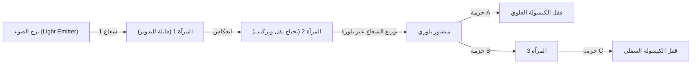
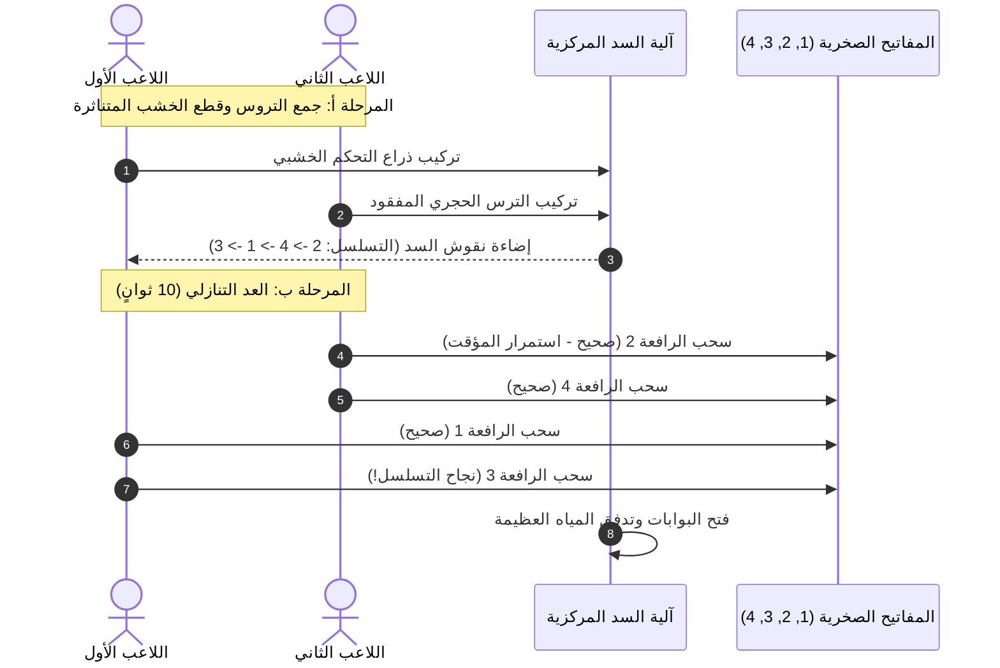

# تصميم المرحلة والألغاز (Level Design & Puzzles)
## المرحلة الأولى: الغابة الأسيرة (Level 1: The Captive Forest)

---

## 1. المخطط المكاني للمرحلة (Top-Down Spatial Layout)

تم تصميم المرحلة وفق مسار شبه خطي (Linear with Open Hubs)؛ لضمان عدم تشتيت اللاعبين مع منح حرية كافية للاستكشاف والبحث عن الموارد وحل الألغاز.

```
       [نقطة بداية Player 1]                  [نقطة بداية Player 2]
                │                                      │
                ▼                                      ▼
        (متاهة الضباب والشجر)                  (المنحدر الصخري المعتم)
                │                                      │
                └───────────────► [ 1 ] ◄──────────────┘
                           (ملتقى الجسر الخشبي)
                                   │
                                   ▼
                           [ 2. وادي الضوء ]
                        (كبسولة الضوء + المرايا)
                                   │
                                   ▼
                           [ 3. سد المياه ]
                     (مجرى النهر الجاف + التروس الحجرية)
                                   │
                                   ▼
                        [ 4. الشجرة العملاقة ]
                     (جذور الرياح + الروافع المتزامنة)
                                   │
                                   ▼
                           [ 5. بوابة العبور ]
                      (النهائي المكتمل نحو العالم 2)
```

---

## 2. تفاصيل هندسة الألغاز الثلاثة (Deep Dive Puzzle Mechanics)

---

### اللغز الأول: لغز كبسولة الضوء وانعكاس المرايا (The Light Prism Puzzle)

#### الفكرة والمفهوم:
تحرير أول عناصر الحياة عبر توجيه شعاع ضوئي سحري منبعث من برج بلوري نحو ثلاث نقاط استقبال في "كبسولة الضوء الزجاجية".



#### المواصفات التقنية والميكانيكية:
1. **فيزياء ارتداد الضوء (Physics Raycasting):**
   يتم حساب ارتداد الشعاع باستخدام دالة الانعكاس الرياضية:
   $$\vec{R} = \vec{D} - 2(\vec{D} \cdot \vec{N})\vec{N}$$
   حيث $\vec{D}$ هو متجه الشعاع الساقط، و $\vec{N}$ هو المتجه العمودي لسطح المرآة.
2. **العقبات والتكامل بين اللاعبين:**
   - **اللاعب الأول:** يتولى تدوير المرآة الأولى بزاوية دقيقة على منصة مرتفعة، ولا يستطيع رؤية النقطة النهائية للكبسولة لأنها تقع خلف حاجز صخري.
   - **اللاعب الثاني:** يتمركز عند الكبسولة لمراقبة مسار الشعاع ويوجه شريكه صوتياً ("زد الدوران قليلاً نحو اليمين"). كما يقوم بالبحث عن "المرآة الثانية" ونقلها إلى قاعدتها الحجرية الخالية لإكمال المسار.
3. **حالة النجاح (Win Condition):**
   سقوط الحزم الضوئية على أقفال الكبسولة لمدة 2 ثانية متواصلة؛ مما يؤدي إلى تصدع الزجاج وانفجار الضوء المحرر في أرجاء الغابة.

---

### اللغز الثاني: لغز سد المياه والتسلسل الزمني (The Dam & Timed Sequence)

#### الفكرة والمفهوم:
إعادة المياه إلى النهر الجاف عبر تفعيل بوابات السد الحجري العملاق، والذي يتطلب مرحلتين: إصلاح الآلية الميكانيكية، ثم إدخال الشيفرة الزمنية.



#### عناصر التحدي والمهارة:
1. **توزيع الأدوار الجغرافي:**
   المفاتيح موزعة على جانبي السد العريض (مفتاحان في الجانب الأيسر، ومفتاحان في الأيمن)، وتفصل بينهما مسافة تستغرق 8 ثوانٍ من الركض. من المستحيل فيزيائياً للاعب واحد أن يركض بين جميع المفاتيح الأربعة خلال الـ 10 ثوانٍ المتاحة.
2. **عقاب الخطأ الذكي (Fail-Safe Mechanism):**
   إذا تم ضغط مفتاح خاطئ أو انتهى الوقت، تصدر الآلية صوتاً حركياً ثقيلاً وترتفع المفاتيح من جديد بدون قتل اللاعبين أو إحباطهم، مع تغيير خفيف في التسلسل لضمان استمرار التركيز وتنشيط الذاكرة.

---

### اللغز الثالث: لغز الشجرة العملاقة والتحكم المزدوج المتزامن (The World Tree & Dual Synchronization)

#### الفكرة والمفهوم:
الرياح محبوسة في تجويف الشجرة الأسطورية عبر جذور سوداء متشابكة؛ يتطلب فكها صعود اللاعبين إلى شرفتين علويتين في الشجرة وتفعيل رافعتين رئيسيتين في وقت واحد بدقة متناهية.

```
                  [قمة الشجرة الأسطورية]
                       /          \
                      /            \
       [المنصة الغربية]            [المنصة الشرقية]
       [رافعة الرياح A]            [رافعة الرياح B]
              ▲                           ▲
              │ (مسار القفزات المنصية)     │ (مسار مصعد الحبال اليدوي)
              │                           │
       [اللاعب الأول P1]           [اللاعب الثاني P2]
```

#### قواعد التزامن الزمني (Synchronous Logic):
1. **معيار التزامن الرياضي:**
   عندما يسحب اللاعب الأول الرافعة عند الزمن $T_1$، يتم تفعيل نافذة سماحية زمنية حرجة:
   $$|T_1 - T_2| \le \Delta t_{\text{threshold}} \quad (\Delta t = 0.5 \text{ ثانية})$$
2. **التغذية الراجعة البصرية (Visual Radial Fill):**
   بمجرد سحب اللاعب الأول لرفعته، تبدأ حلقة مضيئة بالتلاشي السريع حول الرافعة خلال 0.5 ثانية مصحوبة بصوت شحن سحري متصاعد. إذا قام اللاعب الثاني بسحب رفعته قبل تفريغ الحلقة، تكتمل الدائرة السحرية فوراً.
3. **أثر النجاح:**
   تتحول الجذور السوداء إلى رماد سحري ذهبي يتلاشى، وتنطلق عاصفة رياح تدوي في سماء الغابة وتبدأ أوراق الشجر بالتراقص.

---

## 3. وتيرة اللعب والإرشاد البيئي (Pacing & Signposting)

| المشهد | مستوى التوتر والسرعة | الإرشاد البصري والصوتي (Signposting) |
|---|---|---|
| **1. الاستيقاظ** | استرخاء / استكشاف بطيء | وميض القلادة الأزرق + أصوات الرنين المتقارب. |
| **2. الضوء** | تركيز ذهني / تأمل | انبعاث بصري خافت من البرج + انعكاس زجاجي على أسطح المرايا. |
| **3. الماء** | حماسي / إدارة وقت وتنسيق | صوت خرير السد المكتوم + وميض الرموز الحجرية باللون الفيروزي. |
| **4. الرياح** | ذروة الحماس والبراعة الحركية | دوامة هوائية مرئية في جذع الشجرة + صوت صفير الرياح الحبيسة. |
| **5. النهاية** | انتصار / بهجة واسترخاء | إضاءة ذهبية غامرة، انسياب النهر والرياح، وبوابة سحرية عملاقة مفتوحة. |
