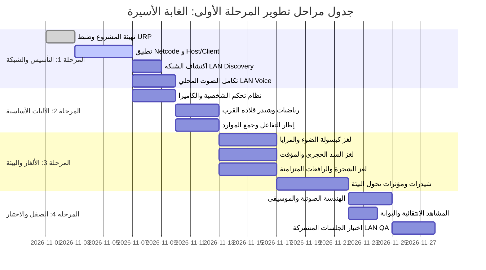

# جدول المهام وخطط التنفيذ (Work Breakdown Structure & Tasks)
## مشروع: الغابة الأسيرة (The Captive Forest)

---

## 1. خارطة الطريق والمراحل الأربع (Development Milestones)

---

## 2. جدول تفكيك المهام الهندسي (Granular Task Matrix)

### المرحلة الأولى: التأسيس التقني وشبكة الاتصال المحلي (Foundations & LAN Core)

| معرف المهمة | المهمة والوصف | التخصص | الاعتمادية | معيار القبول (Acceptance Criteria) |
|---|---|---|---|---|
| **NET-101** | إنشاء مشروع Unity وضبط URP وإعداد حزم NGO و UTP | مهندس شبكات / تقني | لا يوجد | استقرار المشروع بدون تحذيرات وتثبيت Netcode for GameObjects. |
| **NET-102** | بناء آلية Host-Client Scene Transition | مبرمج أنظمة | NET-101 | قدرة جهازين على الدخول في نفس المشهد ومزامنة الشخصيتين. |
| **NET-103** | برمجة نظام اكتشاف السيرفر التلقائي `LanDiscovery.cs` | مهندس شبكات | NET-102 | ظهور اسم الـ Host على شاشة الـ Client بدون كتابة IP يدوياً. |
| **NET-104** | تكامل البث الصوتي المباشر LAN Voice Chat | مهندس صوت / شبكات | NET-102 | انتقال الصوت بين الميكروفونين بجودة واضحة وزمن تأخير $< 60\text{ms}$. |

---

### المرحلة الثانية: آليات الحركة وقلادة الرنين والموارد (Core Mechanics)

| معرف المهمة | المهمة والوصف | التخصص | الاعتمادية | معيار القبول (Acceptance Criteria) |
|---|---|---|---|---|
| **PLY-201** | برمجة وحدة التحكم بالحركة ثلاثية الأبعاد والكاميرا | مبرمج أسلوب اللعب | NET-102 | حركة ناعمة، قفز فيزيائي، ودوران كاميرا مريح ومتزامن عبر الشبكة. |
| **PLY-202** | برمجة شيدر ومتحكم قلادة الرنين `PendantResonanceController` | فنان تقني / مبرمج | PLY-201 | زيادة توهج القلادة وتردد نبضها تدريجياً عند اقتراب اللاعبين من بعضهما. |
| **INT-203** | بناء نظام التفاعل العام `IInteractable` ومؤشر التصويب | مبرمج أسلوب اللعب | PLY-201 | ظهور إطار تحديد أو أيقونة عند النظر إلى كائن تفاعلي والضغط على E. |
| **RES-204** | نظام التقاط وحمل الموارد المباشر (خشب / بلورات) | مبرمج أسلوب اللعب | INT-203 | رفع القطعة الخشبية أو البلورة وحملها باليد ووضعها في المكان المخصص. |

---

### المرحلة الثالثة: بناء الألغاز الثلاثة والتحول البيئي (Puzzles & Environment)

| معرف المهمة | المهمة والوصف | التخصص | الاعتمادية | معيار القبول (Acceptance Criteria) |
|---|---|---|---|---|
| **PUZ-301** | برمجة ارتداد الضوء `LightBeamReflector` للمرايا | مبرمج أسلوب اللعب | INT-203 | انعكاس فيزيائي دقيق لشعاع LineRenderer على أسطح المرايا وإصابة الكبسولة. |
| **PUZ-302** | بناء منطق سد المياه وإصلاح التروس والمؤقت الزمني | مبرمج أسلوب اللعب | RES-204 | قبول القطع الخشبية، ثم احتساب التسلسل للمفاتيح الأربعة خلال 10 ثوانٍ. |
| **PUZ-303** | برمجة التفعيل المتزامن المزدوج لشجرة الرياح `SynchronousLever` | مبرمج أسلوب اللعب | INT-203 | نجاح التفعيل فقط إذا كان الفارق الزمني بين سحب الرافعتين $\le 0.5$ ثانية. |
| **ENV-304** | تطوير شيدر ومتحكم التحول البيئي للغابة (نور، ماء، ريح) | فنان تقني (Tech Artist) | PUZ-301, 302, 303 | انتقال سلس للغابة من الظلام والسكون إلى النور وجريان الماء وتمايل الشجر. |

---

### المرحلة الرابعة: التصميم الصوتي والصقل والاختبار (Polish & QA)

| معرف المهمة | المهمة والوصف | التخصص | الاعتمادية | معيار القبول (Acceptance Criteria) |
|---|---|---|---|---|
| **SND-401** | تطبيق الطبقات الصوتية التفاعلية (Adaptive Audio Layers) | مصمم صوتيات | ENV-304 | تصاعد النغمات الموسيقية وإضافة صوت الماء والرياح فور تحرير كل عنصر. |
| **LVL-402** | تصميم المشهد السينمائي الختامي وبوابة العبور للمرحلة 2 | مصمم مراحل | ENV-304 | ظهور البوابة المتوهجة وتفعيل شاشة الانتصار المشترك عند دخول اللاعبين. |
| **TST-403** | اختبارات الجلسة الكاملة عبر شبكة LAN فعلية (End-to-End QA) | مختبر جودة (QA) | الجميع | خلو الجلسة من التقطيع، عمل الألغاز بنجاح كامل، وعدم حدوث Deadlocks. |

---

## 3. خطة إدارة المخاطر التقنية (Technical Risk Management)

| الخطر المحتمل | درجة التأثير | خطة المعالجة الوقائية (Mitigation Strategy) |
|---|---|---|
| **تأخر أو تقطع الصوت في الشبكة المحلية** | عالي | استخدام حزم UDP خفيفة بدون تأكيد استلام (Unreliable)， وخفض تردد العينات إلى 16kHz لتوفير الباندويث. |
| **فروقات التوقيت الدقيقة بين الجهازين في لغز الشجرة** | متوسط | جعل الخادم (Host) هو المرجع الوحيد لقياس الوقت عبر `ServerRpc` وإعطاء هامش سماحية مرن (0.5 ثانية). |
| **عدم عثور الـ Client على الـ Host بسبب جدار حماية Windows Firewall** | عالي | تفعيل فحص جدار الحماية، وتوفير خيار إدخال الـ Local IP يدوياً في واجهة البداية كخيار احتياطي (Fallback Manual IP Input). |
