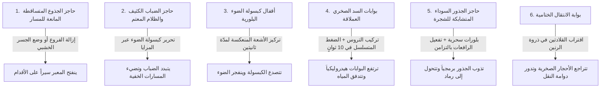

# دليل مهام الفريق وخط إنتاج النماذج ثلاثية الأبعاد (Team Roles & 3D Art Pipeline)
### مشروع: الغابة الأسيرة (The Captive Forest)
**المشرف العام:** م. أحمد ديب (Eng. Ahmed Deeb)  
**ليدر التطوير والبرمجة:** رزان علي أبو سعدة (Razan Abu Saada)  
**الفنان التقني (Technical Art):** ألاء كمال أبو جياب (Alaa Abu Gayyab)  
**فنانة البيئة والنماذج ثلاثية الأبعاد (3D Artist - Blender):** دانا عماد العجوري (Dana Al-Ajouri)  

---

## 1. توزيع الأدوار والمهام التفصيلية لأعضاء الفريق

---

## 0. معرض التصورات البصرية للعبة (Concept Art & Visual Mockups)

تم توليد مجموعة صور تصورية فائقة الدقة (Concept Art) تجسد التوجه البصري والفني للعبة بالكامل، وهي محفوظة مباشرة في مجلد المشروع [`ConceptArt`](file:///d:/UnityProjects/TheCaptiveForest/ConceptArt/):

1. 🌲 **[بيئة الغابة الساكنة والقلادتين (Dormant Forest & Players)](file:///d:/UnityProjects/TheCaptiveForest/ConceptArt/captive_forest_environment_dormant_v2_1794569906731.jpg)**
   - تجسد الغابة المعتمة، الضباب الحجمي، الجفاف، والوميض النيلي للقلادة السحرية حول عنق المغامرَين.
2. 💡 **[لغز كبسولة الضوء والمرايا الحجرية (The Light Capsule & Mirrors)](file:///d:/UnityProjects/TheCaptiveForest/ConceptArt/captive_forest_light_puzzle_1794569936707.jpg)**
   - توضح تصميم المذبح الحجري، كبسولة الضوء الزجاجية، المرايا الحجرية القابلة للدوران، وتعاون اللاعبين في التوجيه والإشارة.
3. 🌪️ **[الشجرة الأسطورية وطوق الجذور السوداء (The Wind Tree & Corrupted Roots)](file:///d:/UnityProjects/TheCaptiveForest/ConceptArt/captive_forest_wind_tree_1794569967419.jpg)**
   - توضح الشجرة العملاقة، طوق الجذور السوداء الشائكة التي تحبس دوامة الرياح، والمنصات الخشبية العلوية ذات الروافع المتزامنة.
4. 🎮 **[واجهة المستخدم وقائمة الربط المحلي (Diegetic HUD & LAN Lobby)](file:///d:/UnityProjects/TheCaptiveForest/ConceptArt/captive_forest_ui_lan_lobby_1794570001548.jpg)**
   - تصميم واجهة اللعب المنعدمة (مؤشر القرب السحري، إشعار التفاعل [E])، وقائمة الانتظار الأنيقة لربط الجهازين عبر شبكة LAN.

---

## 1. توزيع الأدوار والمهام التفصيلية لأعضاء الفريق

```
                             +-----------------------------------+
                             |     م. أحمد ديب (المشرف العام)     |
                             | الإشراف الهندسي، المراجعة، والاعتماد |
                             +-----------------+-----------------+
                                               |
         +-------------------------------------+-------------------------------------+
         |                                     |                                     |
+--------+--------+                   +--------+--------+                   +--------+--------+
|  رزان أبو سعدة   |                   |  ألاء أبو جياب   |                   |   دانا العجوري   |
| Lead Developer  |                   |  Technical Art  |                   |    3D Artist     |
+-----------------+                   +-----------------+                   +-----------------+
| - معمارية الشبكة |                   | - شيدرات URP    |                   | - نمذجة بلندر   |
| - ميكانيكا اللعب |                   | - مؤثرات VFX    |                   | - الأصول المعيارية|
| - مزامنة الألغاز |                   | - إضاءة وبيئات   |                   | - إكساء وتفاصيل |
| - نظام الصوت LAN|                   | - ربط النماذج   |                   | - تصدير FBX     |
+-----------------+                   +-----------------+                   +-----------------+
```

---

### 1.1 مهام م. أحمد ديب (المشرف العام / Project Supervisor)
1. **التوجيه الهندسي والمتابعة الدورية:** التأكد من التزام الفريق بنطاق المشروع (Project Scope) والجدول الزمني.
2. **مراجعة الكود والأداء (Code & Performance Review):** التحقق من جودة الكود البرمجي في Unity Netcode، استقرار معدل الإطارات (FPS)، وانعدام الـ Memory Leaks.
3. **اعتماد تسليمات المراحل (Milestone Approvals):** تقييم واختبار كل مرحلة (الألغاز، الشبكة المحلية، المؤثرات، الجلسة التعاونية).

---

### 1.2 مهام رزان علي أبو سعدة (Developer - Team Leader)
1. **هندسة الشبكة المحلية (Host-Client Architecture):**
   - إعداد حزمة `Unity Netcode for GameObjects (NGO)` و `Unity Transport (UTP)`.
   - برمجة كود البحث التلقائي `LanDiscovery.cs` عبر بروتوكول UDP Broadcast.
   - دمج نظام التواصل الصوتي المباشر بين الجهازين محلياً (LAN Voice Chat).
2. **برمجة ميكانيكا الشخصية والألغاز الثلاثة:**
   - حركة الشخصية بالمنظور الثالث (Third-Person Controller) مع التزامن الشبكي.
   - كود فيزياء انعكاس الضوء على المرايا `LightBeamReflector.cs`.
   - منطق سد المياه والمؤقت الزمني وإصلاح التروس `DamPuzzleController.cs`.
   - منطق التفعيل المتزامن لرافعات الشجرة العملاقة `SynchronousLever.cs`.
3. **إدارة الحالة ومزامنة الأحداث (Game State Manager):**
   - مزامنة تحرير العناصر (نور، ماء، ريح) عبر `NetworkVariable`.
   - إدارة واجهات البداية والانضمام إلى الجلسة.

---

### 1.3 مهام ألاء كمال أبو جياب (Technical Art)
1. **تطوير الشيدرات (Shader Graph):**
   - **شيدر جوهرة القلادة (Pendant Resonance Shader):** توهج انبعاثي (HDR Emission) متناغم مع المسافة وتأثير نبض دوري (Pulse Sin Wave).
   - **شيدر تحول الغابة (Forest Revitalization Shader):** الانتقال التدريجي من الرمادي الباهت إلى النضارة اللونية (Desaturation to Saturation).
   - **شيدر تمايل أوراق الأشجار مع الرياح (Vertex Wind Displacement Shader).**
   - **شيدر المياه والشلالات (Dynamic Water & Waterfall Shader):** حركة جريان السطح ورغوة الشلالات.
   - **شيدر ذوبان الجذور السحرية (Root Dissolve Shader):** ذوبان الجذور المتشابكة باستخدام Noise Texture وتوهج ناري على حواف الذوبان.
2. **المؤثرات البصرية (VFX Graph / Particle Systems):**
   - شعاع الضوء المنعكس وجزيئات الغبار النوراني (God Rays Particles).
   - رذاذ الماء وتدفق الشلال عند انفتاح السد.
   - إعصار الرياح المضغوط وأوراق الشجر المتطايرة عند تحرير الشجرة.
   - البوابة السحرية الختامية وتوهج الروافع.
3. **الإضاءة وما بعد المعالجة (Lighting & Post-Processing):**
   - ضبط الإضاءة الحجمية (Volumetric Fog) لإبراز كآبة الغابة في البداية، وتدرج الضوء الذهبي بعد التحرير.
   - تجهيز خامات PBR وضبط أداء الرندرة (LODs & Occlusion Culling).

---

### 1.4 مهام دانا عماد العجوري (3D Artist - Blender Master)
**المهمة الجوهرية:** تحويل الفكرة والسيناريو إلى أصول ومجسمات ثلاثية الأبعاد (3D Assets) قابلة للتنفيذ في محرك Unity بأسلوب Stylized Fantasy جذاب ومتناسق.

#### قائمة مجسمات البلندر المطلوبة بالتفصيل (Master 3D Asset Checklist):

| الفئة | اسم المجسم (Asset Name) | الوصف الهندسي والمتطلبات | نقطة الارتكاز (Pivot) | ميزانية المضلعات (Tris) |
|---|---|---|---|---|
| **البيئة** | `SM_AncientTree_Colossal` | الشجرة الأسطورية العملاقة بتجويف داخلي محاطة بجذور مفرغة | أسفل القاعدة في المنتصف | 8,000 - 12,000 |
| **البيئة** | `SM_CorruptedRoots_Cage` | شبكة الجذور السحرية السوداء المتشابكة (قابلة للذوبان/الإخفاء) | مركز تجويف الشجرة | 3,000 - 5,000 |
| **البيئة** | `SM_Dam_Wall_Massive` | جدار السد الحجري الضخم مع مخرين مائيين | أسفل الجدار | 6,000 - 8,000 |
| **البيئة** | `SM_Dam_Gate_Door` | بوابات السد الصخرية (تتحرك رأسياً لأعلى) | أسفل البوابة | 1,000 |
| **البيئة** | `SM_DryRiverbed_Modular` | قطع مجرى النهر الجاف المعياري (مستقيم، منحني، صخري) | بداية كل قطعة معيارية | 1,500 للقطعة |
| **الألغاز** | `SM_LightCapsule_Pedestal` | مذبح حجري فوقه كبسولة بلورية مغلقة مع 3 مستقبلات | أسفل القاعدة | 2,500 |
| **الألغاز** | `SM_Mirror_Pedestal_Rotatable` | قاعدة حجرية + قرص مرآة كريستالي عاكس قابل للدوران 360 | في نقطة دوران المرآة | 1,200 |
| **الألغاز** | `SM_Dam_Gear_Console` | لوحة تحكم السد الحجرية مع تجاويف للتروس المكسورة | أسفل المنصة | 1,500 |
| **الألغاز** | `SM_StoneLever_Wall` | رافعة حجرية مثبتة على حامل (تتحرك بزاوية 45 درجة) | عند محور دوران المقبض | 600 |
| **الموارد** | `SM_Resource_WoodGear` | قطع تروس خشبية وأذرع تحكم يحملها اللاعب في يده | في منتصف المجسم | 400 |
| **الموارد** | `SM_Resource_MagicCrystal` | بلورات طاقة سحرية متوهجة قابلة للالتقاط | أسفل البلورة | 300 |
| **الشخصية** | `SM_Player_Adventurer` | شخصية المغامر بأسلوب ستايلايزد مع قلادة واضحة على الصدر | بين القدمين على الأرض | 5,000 - 7,000 |
| **الملحقات**| `SM_Pendant_Gem` | القلادة السحرية وحبلها مع جوهرة بارزة | مركز الجوهرة | 300 |
| **المرحلة** | `SM_FinalPortal_Rune` | البوابة الحجرية الختامية مع نقوش رونية دائرية | مركز البوابة الأرضي | 3,000 |

#### معايير تصدير النماذج من Blender إلى Unity:
1. **المقياس (Scale):** ضبط المقياس في بلندر ليكون `Metric (1 Unit = 1 Meter)`. وتطبيق التحويلات `Apply All Transforms (Ctrl+A -> Rotation & Scale)`.
2. **محاور الإحداثيات (Axes):** تصدير FBX بمحاذاة `-Z Forward, Y Up` لضمان توافقها المباشر مع محاور يونتي دون دوران شاذ.
3. **نقاط الارتكاز (Pivots):** كل باب، رافعة، أو مرآة يجب أن تكون نقطة ارتكازه (Origin Point) عند محور الدوران الفعلي وليس في منتصف الفراغ.
4. **فرد الخامات (UV Unwrapping):** خلو فرد الـ UVs من التداخلات غير المقصودة (Overlaps)، وحفظ مساحة 8-16 بكسل (Padding) بين الجزر لمنع تشوه التكستشر.
5. **الخامات (PBR / Stylized):** الاعتماد على خرائط: Base Color (Albedo), Normal (OpenGL), Metallic/Smoothness, و Ambient Occlusion.

---

## 2. طبيعة وتصميم بيئة الغابة (شكل "المتاهة" والمسار)

الغابة ليست متاهة كلاسيكية من الجدران الإسمنتية الضيقة، بل هي **متاهة طبيعية عضوية (Organic Fantasy Forest Maze)** مستوحاة من البيئات الأسطورية:

```
[منطقة البداية 1]                       [منطقة البداية 2]
(جرف صخري معتم)                         (أشجار عملاقة متلاحمة)
       \                                       /
        \                                     /
         ▼                                   ▼
        +-------------------------------------+
        |  المتاهة التمهيدية (Misty Glades)  |
        |  - ضباب حجمي معتم يحجب الرؤية       |
        |  - تلال صخرية وجذوع ميتة متساقطة     |
        |  - الركيزة: الاستدلال بنبض القلادة  |
        +------------------+------------------+
                           |
                           ▼
                +---------------------+
                | نقطة اللقاء: الجسر  |
                +----------+----------+
                           |
                           ▼
          [واحة كبسولة الضوء والمرايا الحجرية]
                           |
                           ▼
            [مجرى الوادي الجاف نحو السد العظيم]
                           |
                           ▼
            [هضبة الشجرة الأسطورية المحاصرة]
                           |
                           ▼
                 [بوابة العبور المضيئة]
```

### معالم المتاهة وعناصر توجيه اللاعبين:
1. **الارتفاعات والتضاريس:** وجود جدران حجرية طبيعية ومنحدرات وجذور أشجار عملاقة تمنع الانتقال العشوائي وتحدد المسارات.
2. **انعدام الرؤية في البداية:** ضباب رمادي داكن يغطي الغابة، مما يجبر اللاعبين على الاعتماد على **مؤشر القرب الصوتي والضوئي للقلادة** للالتقاء.
3. **المعالم الدالة (Landmarks):** مذبح كبسولة الضوء المتوهج، الجدار الشاهق للسد، والقمة الضخمة للشجرة الأسطورية تعمل كأبراج إرشادية مرئية في الأفق.

---

## 3. هندسة الحواجز وكيفية فتحها وتفكيكها (The Barriers Breakdown)

تتضمن المرحلة الأولى **6 حواجز رئيسية**، تختلف طريقة فتحها وتفكيكها بين حل الألغاز، واستخدام الموارد، والقطع الفيزيائي:



### تفاصيل الحواجز وآلية إزالتها:

#### 1. حاجز الجذوع المتساقطة والصخور (Fallen Wood Barrier)
* **الشكل والمظهر:** جذع شجرة ضخم ساقط تعلوه فروع شائكة يغلق ممراً ضيقاً بين صخرتين.
* **كيفية الفتح / الإزالة:**
  * يجد اللاعب أداة أو يقوم بسحب الفروع الشائكة باليد (`[E] Clear Debris`).
  * أو جمع 3 قطع خشبية قوية من المحيط ووضعها كمعبر خشبي (Ramp / Plank Bridge) للقفز فوق الجذع الساقط والوصول للطرف الآخر.

#### 2. حاجز الضباب الحجمي والظلام (The Volumetric Fog Barrier)
* **الشكل والمظهر:** جدار من الضباب الداكن الكثيف جداً والظلام الحالك يمنع دخول اللاعبين؛ إذا دخل اللاعب يبدأ بالتعثر وتعود الكاميرا للخلف (Soft invisible wall via environment).
* **كيفية الفتح:**
  * لا يفتح بالقوة، بل يتبدد فور **تحرير عنصر الضوء**؛ حيث يرسل كود `WorldRestorationManager` إشارة لخفض كثافة الضباب `Fog Density` في الـ URP Volume من `0.08` إلى `0.01`، مما يكشف الوادي الممتد للسد الحجري.

#### 3. كبسولة الضوء الزجاجية المقفلة (The Light Capsule Locks)
* **الشكل والمظهر:** قبة زجاجية سحرية محاطة بثلاثة أقفال بلورية حجرية معتمة.
* **كيفية الفتح:**
  * تدوير 3 مرايا حجرية وتثبيت مرآة ناقصة لترتد حزم الضوء وتسقط على الأقفال الثلاثة في آن واحد.
  * عند سقوط الأشعة، تصدر الأقفال رنيناً وتتحول إلى اللون الذهبي، ثم ينفجر الزجاج بتأثير جزيئي (VFX Shatter) وينطلق الضوء.

#### 4. بوابات السد الصخري الهيدروليكية (Massive Sluice Gates)
* **الشكل والمظهر:** بوابتان صخريتان عملاقتان محكمتا الإغلاق تحبسان بحيرة الماء خلف السد.
* **كيفية الفتح:**
  * **المرحلة 1:** تركيب ذراع خشبية وترس مفقود في منصة التحكم الحجرية.
  * **المرحلة 2:** إدخال التسلسل الصخري (المفاتيح 1 إلى 4) بالتنسيق بين اللاعبين خلال مؤقت مدته 10 ثوانٍ.
  * **الحركة الميكانيكية:** ترتفع البوابتان رأسياً ببطء مع صوت صرير حجري واهتزاز للكاميرا (Camera Shake)، وتندفع المياه لملء النهر الجاف.

#### 5. طوق الجذور السوداء السحرية للشجرة (The Corrupted Root Cage)
* **الشكل والمظهر:** شبكة كثيفة ومخيفة من الجذور السوداء الشائكة تلتف حول جذع الشجرة العملاقة كأصفاد حديدية، وتحبس في المركز إعصار الرياح المتوهج.
* **كيفية القطع والتفكيك:**
  * **القطع السفلي:** وضع "البلورات السحرية" في محرابين حجريين بجانب الشجرة، فيشتعل محراب الطاقة ويبدأ الجزء السفلي من الجذور بالتراجع مفسحاً المجال للصعود.
  * **التفكيك الكامل:** صعود اللاعبين إلى المنصتين وسحب رافعتين في وقت متزامن بالضبط ($\Delta t \le 0.5\text{s}$).
  * **المؤثر البصري للشيدر (Dissolve Shader):** لا تختفي الجذور فجأة؛ بل يتم تشغيل شيدر التآكل (Burn/Dissolve Shader)؛ فتشتعل حواف الجذور بخطوط برتقالية متوهجة وتتفتت الجذور تدريجياً متحولة إلى رماد وجزيئات ذهبية متطايرة تكشف تجويف الشجرة، لتنطلق الرياح وتملأ الأفق.

#### 6. البوابة الختامية (The Final Ancient Gateway)
* **الشكل والمظهر:** هيكل قوسي من الحجارة الأسطورية منقوش عليه رموز العناصر الثلاثة (شمس، قطرة ماء، دوامة ريح).
* **كيفية الفتح:**
  * عند إكمال تحرير العناصر الثلاثة، يقترب اللاعبان معاً من البوابة.
  * عند وصول المسافة بينهما إلى أقل من 3 أمتار، تبلغ القلادتان ذروة الرنين، فتشعان هالة نورانية تشحن رموز البوابة.
  * تتحرك الصخور الجانبية وتفتح دوامة دائرية سحرية زرقاء وذهبية يعبر من خلالها اللاعبان لإنهاء المرحلة الأولى والانتقال للمرحلة التالية.
